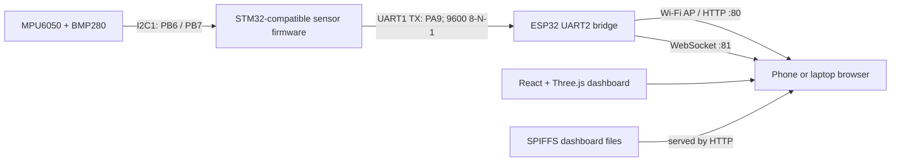

# SkyLink

SkyLink is a telemetry and visualization prototype. Its objective is to make local sensor readings easy to inspect and demonstrate attitude/altitude visualization without a cloud service. STM32 firmware reads an MPU6050-compatible IMU and BMP280 barometer, sends attitude and relative-altitude samples over UART to an ESP32, and the ESP32 hosts a browser dashboard over its Wi-Fi access point. The dashboard renders the values, plots their history, and animates a Three.js model.

**SkyLink is not an autonomous flight controller.** It does not control motors, estimate a navigation-grade position, or provide flight-safety functions. Demo telemetry is simulated and must not be mistaken for sensor data.

## Features

- Roll, pitch, yaw-rate, and relative-altitude telemetry from the STM32.
- ESP32 Wi-Fi access point, HTTP dashboard hosting from SPIFFS, and WebSocket telemetry on port 81.
- React dashboard with demo and live modes, connection/error/staleness status, charts, and 3D visualization.
- Laptop development mode using Vite; demo mode works without an ESP32.
- Firmware and filesystem builds with PlatformIO, plus an SPIFFS preparation and verification script.

## Architecture



The STM32 firmware is the root [`main.c`](./main.c). The ESP32 firmware is [`firmware/esp32_websocket_bridge/esp32_websocket_bridge.ino`](./firmware/esp32_websocket_bridge/esp32_websocket_bridge.ino). PlatformIO compiles it through [`pio_src/main.cpp`](./pio_src/main.cpp), which includes the maintained sketch rather than duplicating it. The React source is under [`web/src/`](./web/src/). Details are in [architecture](./docs/architecture.md), [hardware](./docs/hardware.md), and [protocol](./docs/communication_protocol.md).

## Hardware

The project brief identifies an ESP32-D0WD-V3 development board, and PlatformIO selects the generic `esp32dev` target. The exact STM32 development-board model is not recorded; the source describes an HK32F103/STM32F103-compatible register map. Verify the actual boards and sensor breakout wiring before applying power.

Verified signal assignments:

| Signal | Connection |
|---|---|
| MPU6050/BMP280 I2C | STM32 I2C1 on PB6 (SCL) and PB7 (SDA) |
| STM32 UART output | USART1 TX on PA9 to ESP32 GPIO16 (UART2 RX) |
| ESP32 UART return | GPIO17 (UART2 TX), configured but unused by the one-way telemetry link |
| Ground | STM32 and ESP32 grounds must be common |

Use 3.3 V-compatible UART logic; do not connect a 5 V TX signal directly to the ESP32. The source does not specify the sensor breakout supply circuitry, USB connector types, or exact STM32 board, so check the markings and manufacturer documentation for those details. See [hardware documentation](./docs/hardware.md).

## Telemetry and network endpoints

The STM32 sends newline-terminated frames such as:

```text
R:12.35,P:-4.12,Y:0.04,Alt:0.02
```

`R` and `P` are degrees, `Y` is yaw angular rate in degrees per second (not compass heading), and `Alt` is relative altitude in metres. UART is 9600 baud, 8-N-1. The ESP32 validates all four finite numeric fields and rejects malformed, repeated, missing, or oversized frames. The browser validates packets again.

| Service | Endpoint |
|---|---|
| Dashboard | `http://192.168.4.1/` |
| Status JSON | `http://192.168.4.1/status` |
| Telemetry WebSocket | `ws://192.168.4.1:81` |

The AP SSID and credentials are configured in the ESP32 sketch. Change the default credentials to deployment-specific values before deployment; credentials are intentionally not repeated in this documentation. The full packet and status response are documented in [communication_protocol.md](./docs/communication_protocol.md).

## Software requirements

- VS Code with the PlatformIO IDE extension (or PlatformIO Core).
- PlatformIO Espressif32 platform `8.0.0`.
- Arduino-ESP32 framework package `4.30312.261024` (Arduino core `3.3.12`).
- WebSockets library `2.7.2`.
- Node.js `18` or later and npm, for the frontend.
- Python `3.10` or later, for [`scripts/prepare_spiffs.py`](./scripts/prepare_spiffs.py). The script uses the Python standard library.
- Frontend libraries and tool versions are pinned by [`web/package-lock.json`](./web/package-lock.json); the application uses React, Three.js / React Three Fiber, Recharts, and Lucide.

The PlatformIO configuration uses the `esp32dev` board target, 4 MB flash, DIO mode at 80 MHz, [`partitions/no_ota.csv`](./partitions/no_ota.csv), and SPIFFS. Its SPIFFS partition is `0x1E0000` bytes; keep this partition table and the framework include workaround in [`scripts/platformio_framework_includes.py`](./scripts/platformio_framework_includes.py) unchanged unless the firmware and deployment are deliberately revalidated.

## Clone and install

```powershell
git clone https://github.com/nothingmatters05/SkyLink.git
cd SkyLink
```

Install the PlatformIO IDE extension in VS Code (or install PlatformIO Core) and open the repository root. Install the exact frontend dependencies from the lockfile with `npm.cmd ci` from `web/`; the build steps below run the project checks.

## Build

Run these commands from the repository root in PowerShell:

```powershell
cd .\web
npm.cmd ci
npm.cmd run build
cd ..
python .\scripts\prepare_spiffs.py
```

The frontend build runs TypeScript project checks and Vite. The preparation script copies the built site to the ignored PlatformIO `data` directory, checks asset references, file sizes and SPIFFS path lengths, invokes PlatformIO's filesystem build, verifies the image contents, and writes `firmware/esp32_websocket_bridge/spiffs.bin`. It requires PlatformIO Core and its `mkspiffs` tool to be installed. To build firmware separately:

```powershell
$pio = Join-Path $env:USERPROFILE ".platformio\penv\Scripts\pio.exe"
& $pio run -e skylink-esp32
```

To rebuild only the PlatformIO filesystem image after the `data` directory has been prepared:

```powershell
& $pio run -e skylink-esp32 -t buildfs
```

Build and deployment details, including output paths and upload procedures, are in [build_and_deployment.md](./docs/build_and_deployment.md). No hardware upload is performed by these build commands.

## ESP32 deployment

1. Build the React site and prepare the SPIFFS image using the commands above.
2. Build the ESP32 firmware with `& $pio run -e skylink-esp32`.
3. Set `upload_port` in `platformio.ini` to the port for the target device.
4. Upload firmware with `& $pio run -e skylink-esp32 -t upload`.
5. Upload the prepared filesystem with `& $pio run -e skylink-esp32 -t uploadfs`.
6. Connect to the ESP32 access point and open `http://192.168.4.1/`.

The upload commands are documented for deployment and were **not run** as part of this cleanup. SPIFFS mounting uses formatting disabled; do not select a format-on-upload or erase action for routine firmware updates.
The production dashboard starts in Live mode and connects to the page host's WebSocket on port 81. Switch to Demo mode if no ESP32 telemetry source is available.

## Laptop development and modes

```powershell
cd .\web
npm.cmd run dev
```

Open the Vite URL shown in the terminal. The development dashboard starts in Demo mode, which requires no ESP32. Choose Live mode to connect to the ESP32; a local Vite page defaults to `ws://192.168.4.1:81`. For another development endpoint, set `VITE_TELEMETRY_WS_URL` before starting Vite:

```powershell
$env:VITE_TELEMETRY_WS_URL = "ws://192.168.4.1:81"
npm.cmd run dev
```

The override is used only by the Vite development build. Production firmware-hosted pages derive the WebSocket host from the page URL and use port 81. A user can still edit the URL in the dashboard. See [build and deployment](./docs/build_and_deployment.md) for both modes.

## Project structure and generated files

```text
firmware/esp32_websocket_bridge/   ESP32 sketch and generated SPIFFS input/output
partitions/                        ESP32 partition table
pio_src/                           PlatformIO wrapper for the maintained ESP32 sketch
scripts/                           Framework include workaround and SPIFFS builder
web/                               React + Vite frontend
docs/                              Architecture, hardware, protocol, deployment, troubleshooting
main.c                             STM32-compatible sensor/telemetry firmware source
platformio.ini                     ESP32 PlatformIO environment
```

`web/node_modules/`, `web/dist/`, `.pio/`, the generated ESP32 `data/` directory, Python caches, local `.env` files, and `spiffs.bin` are build or machine-local outputs and are ignored by Git. The `data/` directory is still a PlatformIO build input; `prepare_spiffs.py` recreates it from `web/dist/`.

## Troubleshooting

- **ESP32 not detected / wrong port:** check the USB data cable and board-specific serial driver, then update `upload_port` in `platformio.ini`.
- **Website missing or SPIFFS mount fails:** rebuild with `python .\scripts\prepare_spiffs.py`, upload the filesystem for the matching partition table, and check the serial log.
- **WebSocket connects but no data:** verify STM32 PA9 TX → ESP32 GPIO16 RX, common ground, 9600 8-N-1, and valid newline-terminated `R/P/Y/Alt` frames.
- **Invalid or stale readings:** all four values must be finite; the dashboard marks the stream stale after 2 seconds without a valid frame.
- **PlatformIO/frontend build failure:** open the repository root, install the pinned packages, and run `npm.cmd ci` from `web/` before building.

See [troubleshooting.md](./docs/troubleshooting.md) for the complete diagnostic steps.

## Limitations, future work, credits, and license

The current scope is sensor telemetry and browser visualization. There is no autonomous flight control, motor actuation, absolute heading, or navigation system. Sensor sampling/calibration behavior is implemented in the existing STM32 source; it is not changed by the ESP32 website workflow. Potential future work includes documenting the exact STM32 board and sensor breakouts, adding repeatable STM32 build/test tooling, and adding hardware-in-the-loop tests.

No separate credits or license are recorded in the repository. No license is implied by this documentation; add a license only after the project owner chooses one.
