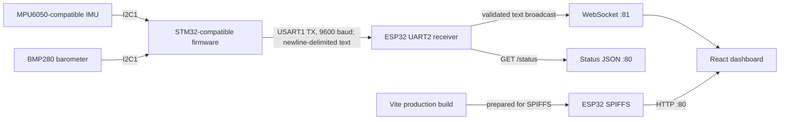

# Architecture

SkyLink has three independently useful parts: STM32 sensor firmware, ESP32 transport/hosting firmware, and a React browser application. The STM32 source is not part of the PlatformIO ESP32 build.

## Data and delivery path

### STM32 sensor acquisition

[`main.c`](../main.c) configures the I2C and USART registers directly for an HK32F103/STM32F103-compatible target. The MPU6050-compatible device is addressed at `0x68`; the BMP280 is probed at `0x76` and then `0x77`. The firmware calibrates the gyroscope at startup, captures a pressure baseline, computes roll and pitch from accelerometer/gyro measurements, derives yaw rate from the gyroscope, and emits the text protocol described in [communication_protocol.md](./communication_protocol.md). The exact physical STM32 board is not identified in the repository.

The telemetry output is sensor data for visualization, not actuator commands. There is no motor mixer, motor output stage, autonomous navigation, or flight-control loop in this project.

### ESP32 bridge and website host

[`esp32_websocket_bridge.ino`](../firmware/esp32_websocket_bridge/esp32_websocket_bridge.ino) uses UART2 RX on GPIO16, buffers one bounded line at a time, validates the four fields, and broadcasts only valid frames. Wi-Fi AP, HTTP, WebSocket, and UART servicing occur from the Arduino `loop()`. AP startup failures are retried; SPIFFS is mounted without auto-formatting so a mount error does not erase the filesystem or stop telemetry services.

The HTTP server listens on port 80. It serves files from SPIFFS with MIME types and cache headers, responds to `/status`, uses `index.html` for extensionless application routes, and returns 404 for missing file-like paths. The WebSocket server listens on port 81 and broadcasts valid UART frames as text. New WebSocket clients receive subsequent frames; the server does not send a cached sample upon connection.

[`pio_src/main.cpp`](../pio_src/main.cpp) is a small PlatformIO entry point that includes the maintained `.ino` file. [`scripts/platformio_framework_includes.py`](../scripts/platformio_framework_includes.py) adds framework include paths needed by the selected Arduino-ESP32 package. PlatformIO reads frontend files from `firmware/esp32_websocket_bridge/data/`; that directory is generated by [`prepare_spiffs.py`](../scripts/prepare_spiffs.py) and ignored by Git.

### Browser application

The Vite build in [`web/`](../web/) hosts the React dashboard in development or generates static assets for SPIFFS. The UI offers demo and live telemetry modes, charts, connection state and stale-data indication, a configurable WebSocket URL, and a Three.js scene with camera and axis controls.

[`parseTelemetry.ts`](../web/src/communication/parseTelemetry.ts) validates incoming text frames. [`useTelemetrySocket.ts`](../web/src/communication/useTelemetrySocket.ts) owns the WebSocket lifecycle, timeout, reconnection, and freshness tracking. Production pages start in Live mode and connect to the page host on port 81; users can switch to Demo mode if no ESP32 is available. Vite development starts in Demo mode, and the optional `VITE_TELEMETRY_WS_URL` override applies only there.

The browser's default scene mapping reverses the pitch sign for its display coordinate convention. It does not rewrite STM32 telemetry. The reported yaw value is angular rate; the dashboard integrates it into a browser-relative heading and cannot provide absolute compass direction.

## Runtime limitations

- The AP, `/status`, and WebSocket endpoint do not provide TLS or user authentication; use this prototype only on an appropriately controlled local network.
- UART loss, sensor disconnection, and stale measurements are surfaced as telemetry/link state, not recovered through a flight-safety mechanism.
- Browser history and yaw integration are session-local visualizations, not durable recording or navigation.
- No physical-device behavior is asserted by software build success alone.
